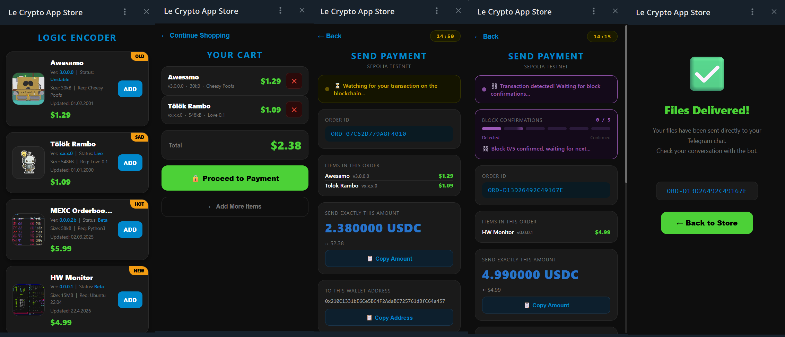
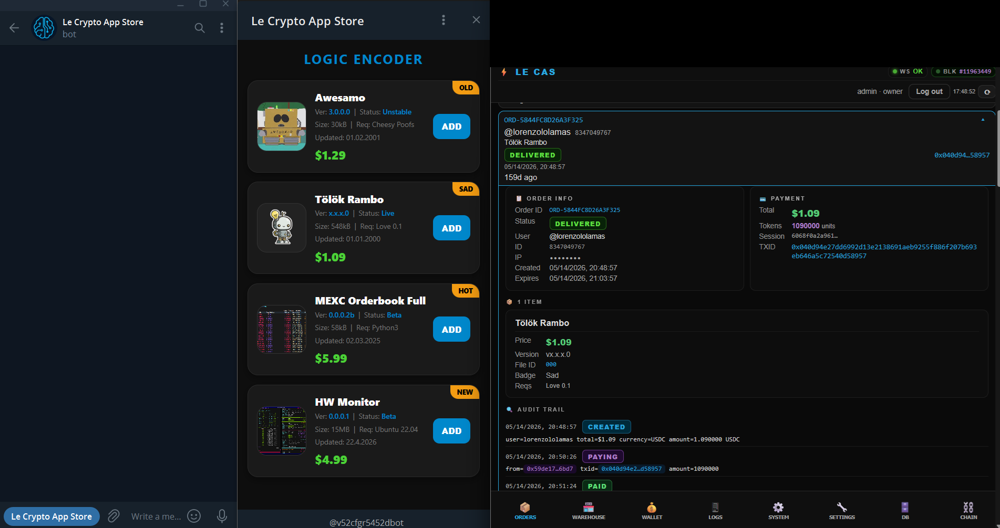
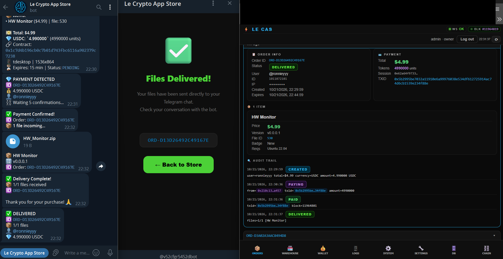
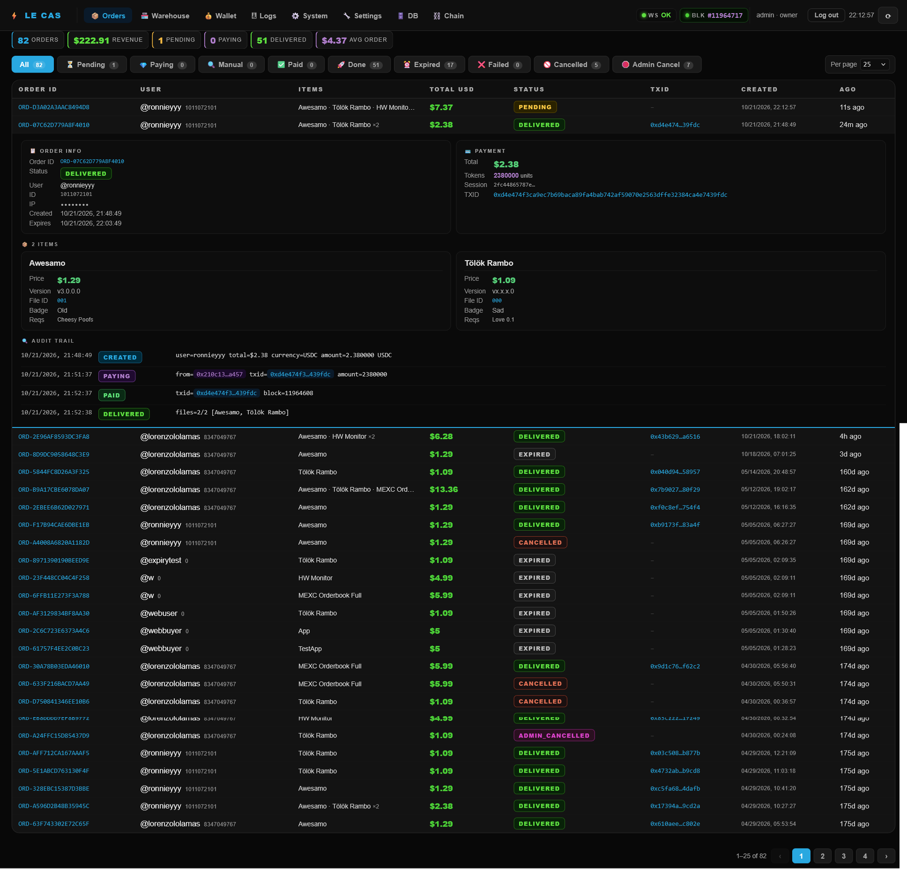
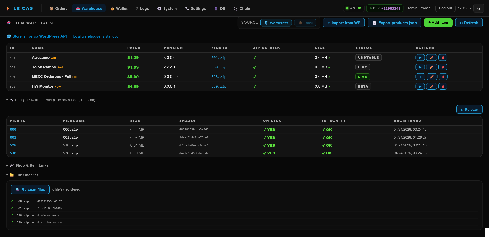
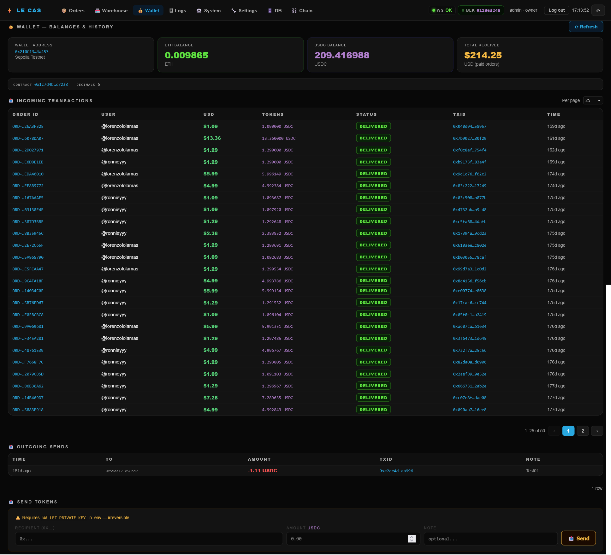
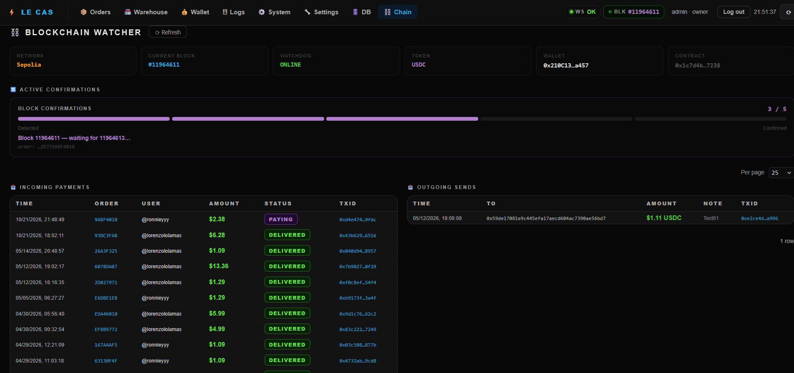
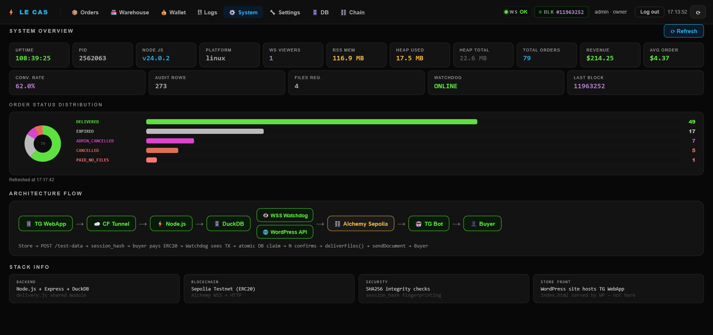
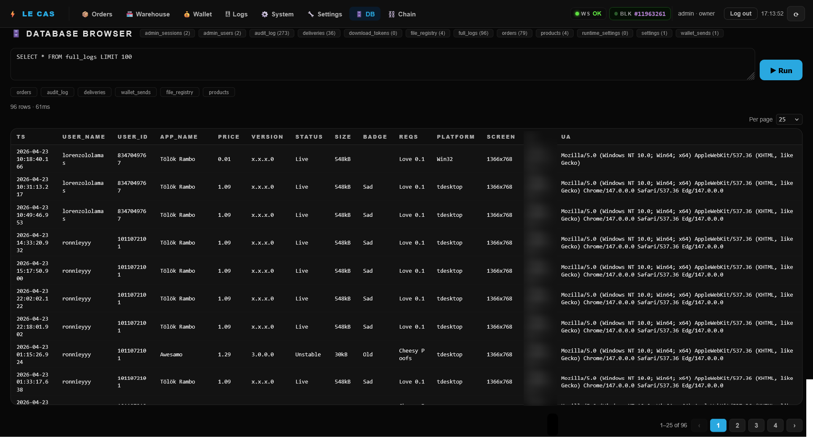
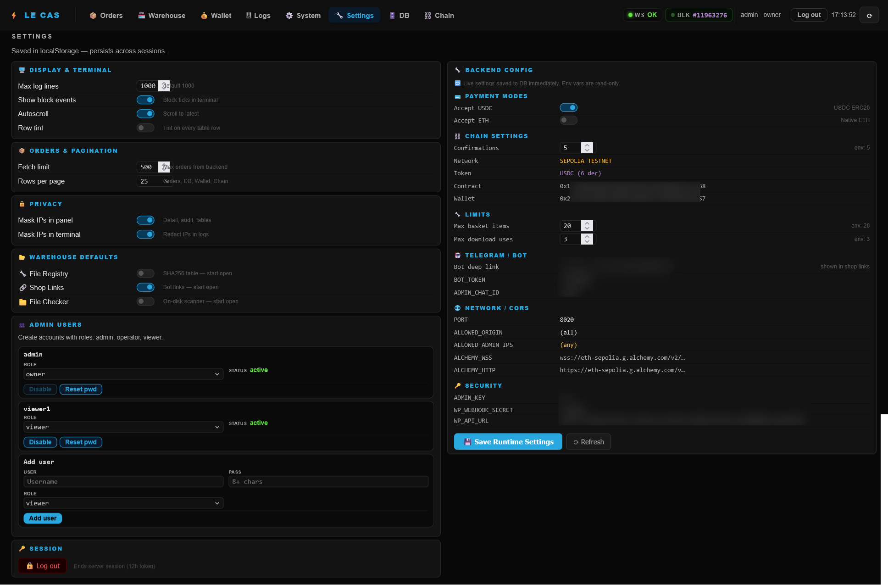

# Logic Encoder Crypto App Store

Selling digital products involves more than collecting a payment. Someone has to connect the purchase to the right files, keep the buyer informed and know whether delivery completed. Logic Encoder Crypto App Store brings that work into one purchase flow inside Telegram, with a browser storefront and a shared operator workspace.

The project began because its creator could not find an existing solution that fit the intended shopping and delivery experience. Building a dedicated store made it possible to bring product selection, payment progress and file delivery together, with one dashboard for managing the sale and handling exceptions.

It also served as a practical testbed for implementing and evaluating different security protections in a working application. This made security an explicit part of the project's purpose alongside the shopping experience, with attention to buyer access, administrative permissions and protected delivery.

Buyers can choose an application, pay and receive their files in the same conversation. Operators can follow the sale, investigate a problem and manage the catalogue from one dashboard, reducing routine checking and manual handoffs.

Open the [Telegram store](https://t.me/v52cfgr5452dbot/cryptoshop) or [browser storefront](https://logicencoder.com/app/).

## Tech stack

| Layer | Technologies |
|---|---|
| Application | JavaScript, Node.js, Fastify |
| Interfaces | HTML, CSS, JavaScript |
| Data | DuckDB |
| Telegram | Telegram Mini Apps, Telegraf |
| Payments | Ethereum, USDC, ETH, ethers |
| Live updates | WebSockets |
| Catalogue integration | WordPress |

## Browse and buy inside Telegram

The storefront presents applications with images, descriptions, prices, versions and optional badges. Buyers can compare the available products and build a basket without leaving Telegram.

The cart brings selected items and their total together before checkout. Products can be removed individually, making it easy to adjust the purchase before proceeding. Direct product links also let someone arrive at a particular application from an announcement.

A regular browser provides another way to use the storefront. The product selection and purchase journey remain familiar across the two entry points.

## Clear instructions from checkout to confirmation

The payment screen gives buyers the information needed to complete the purchase: an order reference, selected items, exact amount, destination address and remaining payment time. Copy controls and supported wallet options reduce retyping.

Configured payment modes include USDC and ETH. The selected network is shown clearly, including test-network identification when applicable. Buyers who have already sent a payment can submit its transaction reference for verification.

Progress stays visible as the purchase moves from waiting for payment through detection and confirmation to delivery. Buyers can see that the transaction has been noticed and understand when the store is still waiting for confirmation, reducing uncertainty and unnecessary support messages.

## Files delivered into the conversation

After successful payment verification, the bot sends the purchased files directly to the buyer's Telegram chat. Order messages connect the documents to the purchase, and the storefront displays **Files Delivered!** with a route back to shopping.

Browser purchases receive download links through their purchase session. Both delivery paths give the buyer a clear completion step rather than leaving them to request the files manually.

Delivery issues remain visible to the operator when intervention is needed. The completed purchase below brings the buyer's confirmation, received document and order history together.

## Follow every order from one workspace

The **Orders** area gives operators a live view of the sales queue. Summary figures and status filters make it easier to distinguish purchases waiting for payment, transactions being confirmed, completed deliveries and orders needing attention.

Opening an order reveals the purchased products, payment information and a chronological history. Transaction links provide a route to check the payment externally, while eligible cancellation controls support intervention when necessary.

The value is continuity: the operator can answer “what happened to this purchase?” without reconstructing the story from a chat, a wallet and a separate delivery record.

## Keep products ready for sale

The **Warehouse** brings catalogue information and deliverable availability together. Add and edit products, maintain prices and versions, manage availability and review the files associated with each application.

File checks help identify missing or problematic deliverables before a buyer reaches checkout. Catalogue import and export support maintenance, while copyable shop and product links simplify sharing new releases.

Products can be maintained locally or through the WordPress catalogue connection. This gives the operator a choice of editing workflow while keeping sale readiness visible in the store's own workspace.

## Reconcile payments without losing the order context

The **Wallet** area combines balances with incoming and outgoing payment history. Incoming records retain their order references and statuses, making it easier to connect received funds with the corresponding purchase.

Transaction links support external checks when a payment needs investigation. Outgoing history records transfers and notes, and authorised wallet controls support sending when configured.

Keeping these details beside the order queue reduces the effort involved in checking whether a purchase was paid and how its payment was handled.

## See confirmation progress as it happens

The **Chain** workspace gives operators a focused view of payment monitoring. Network information, watcher status and the latest observed block provide context, while active confirmation cards show purchases still being confirmed.

This helps distinguish an ordinary wait for confirmations from a connection issue. Incoming and outgoing payment lists keep the broader payment activity available without obscuring the current purchase.

Provider-priority settings offer control over which configured connection services the shop prefers. Operators can adjust that preference from the dashboard as their needs change.

## Investigate issues with live logs

The **Logs** workspace collects operational messages in a searchable, filterable view. Focus on orders, payment monitoring or errors to follow the part of the purchase journey that needs attention.

Pause and autoscroll controls support both live observation and careful reading. Display and privacy preferences make the workspace easier to use during support or screen sharing.

Logs complement the order history: the purchase detail explains one customer's journey, while the live view helps investigate the surrounding activity.

## Check the shop's overall health

The **System** area brings runtime information, resource usage and order distribution together. It offers a quick way to see whether the shop is active and whether purchases are accumulating in a particular state.

From there, the operator can move into the relevant order, payment view or log stream. The persistent connection and block indicators keep useful health signals visible while working elsewhere in the dashboard.

## Inspect records when support needs more detail

The **DB** workspace gives authorised operators a deeper inspection tool when the usual order panels do not answer a question. Record browsing, query controls and paginated results support investigation of a purchase or delivery.

Keeping this workspace inside the dashboard shortens the path between the customer's order and the additional information needed to understand it.

## Configure the shop and its workspace

**Settings** covers both the shopping service and the operator's preferred dashboard behaviour. Adjust accepted payment modes, confirmation requirements, basket and download limits, and configured provider priority as appropriate for the shop.

Display preferences cover log behaviour, pagination, visual density and warehouse panels. Privacy controls help during demonstrations, while account management lets the owner maintain access and roles for other operators.

The result is a workspace that can support routine sales and occasional support work without repeatedly reconfiguring the tools around it.

## Publish through WordPress when it fits the workflow

The [LE Shop companion](https://github.com/logicencoder/le-shop-plugin-overview) lets product editing remain in WordPress. Maintain application descriptions, images, versions and prices using a familiar publishing workflow, then make those products available in the store.

The local warehouse remains an alternative for operators who prefer to manage products directly in the dashboard. Both approaches keep the buying and delivery experience centred on the store.

## Spend less time coordinating a sale

The buyer journey connects browsing, checkout, payment progress and file receipt. The operator journey connects catalogue readiness, order tracking, payment checks and delivery support. Bringing those tasks together reduces the number of places that need to be checked during a sale.

Automatic delivery handles the routine completion step. Clear order history and visible issues make exceptions easier to investigate. The practical benefit is less manual coordination and a more coherent experience for both the person buying and the person running the shop.

---

Private code: [le-crypto-app-store](https://github.com/logicencoder/le-crypto-app-store)

WordPress companion: [le-shop-plugin-overview](https://github.com/logicencoder/le-shop-plugin-overview)

See [REPOS.md](REPOS.md) for related repositories.

**[Logic Encoder](https://logicencoder.com)** · [GitHub](https://github.com/logicencoder) · [Contact](https://logicencoder.com/contact/)
